# Домашнее задание к занятию 1 «Введение в Ansible» - Розаев А.Ю.

## Подготовка к выполнению

1. Установлен Ansible версии 2.10 или выше.
2. Создан свой публичный репозиторий на GitHub с произвольным именем.
3. Скачан [Playbook](./playbook/) из репозитория с домашним заданием и перенесен свой репозиторий.

## Основная часть

1. Запустить playbook на окружении из `test.yml`, зафиксировать значение, которое имеет факт `some_fact` для указанного хоста при выполнении playbook.
```
"msg": 12
```


2. Найти файл с переменными (group_vars), в котором задаётся найденное в первом пункте значение, и поменять его на `all default fact`.

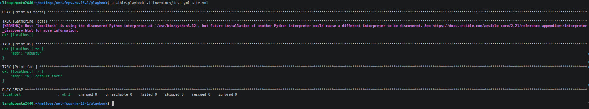


3. Подготовить окружение (используется `docker`)
4. Провести запуск playbook на окружении из `prod.yml`. Зафиксировать полученные значения `some_fact` для каждого из `managed host`.
```
"msg": "el"
```
```
"msg": "deb"
```

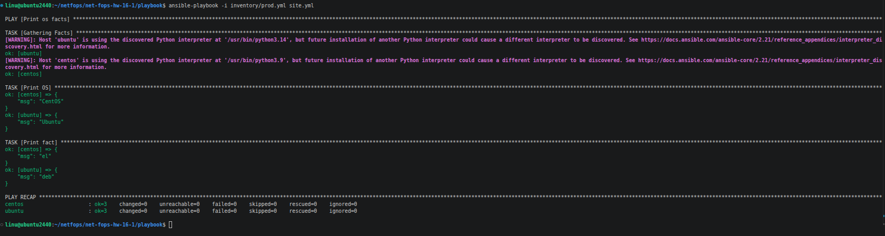

5. Добавить факты в `group_vars` каждой из групп хостов так, чтобы для `some_fact` получились значения: для `deb` — `deb default fact`, для `el` — `el default fact`.
6.  Повторить запуск playbook на окружении `prod.yml`. Убедиться, что выдаются корректные значения для всех хостов.

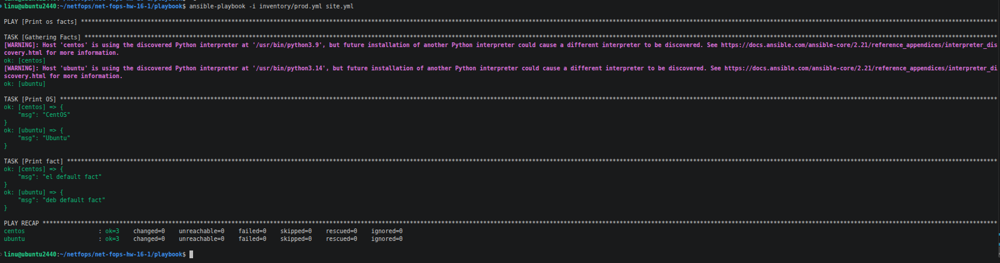

7. При помощи `ansible-vault` зашифровать факты в `group_vars/deb` и `group_vars/el` с паролем `netology`.

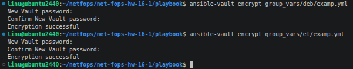

8. Запустить playbook на окружении `prod.yml`. При запуске `ansible` должен запросить пароль. Убедиться в работоспособности.

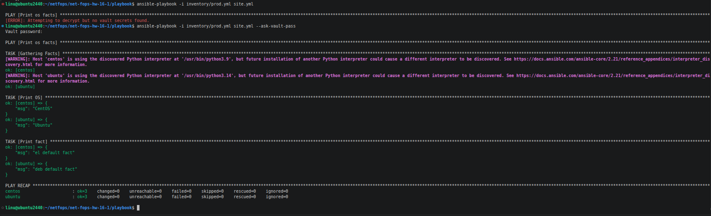

9. Посмотреть при помощи `ansible-doc` список плагинов для подключения. Выберать подходящий для работы на `control node`.
```
CONNECTION ansible.builtin.local (/usr/lib/python3/dist-packages/ansible/plugins/connection/local.py)

  This connection plugin allows ansible to execute tasks on the Ansible 'controller' instead of on a remote host.
```
10. В `prod.yml` добавить новую группу хостов с именем  `local`, в ней разместить localhost с необходимым типом подключения.

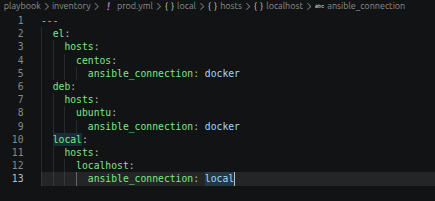

11. Запустить playbook на окружении `prod.yml`. При запуске `ansible` должен запросить пароль. Убедиться, что факты `some_fact` для каждого из хостов определены из верных `group_vars`.

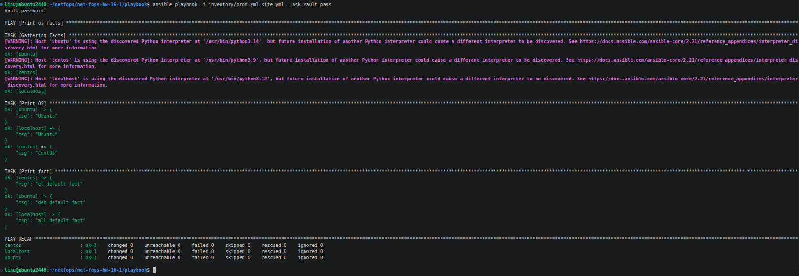

12. Заполнить `README.md` ответами на вопросы. Сделать `git push` в ветку `main`. В ответе отправить ссылку на открытый репозиторий с изменённым `playbook` и заполненным `README.md`.
13. Предоставить скриншоты результатов запуска команд.

---

## Необязательная часть

---

1. При помощи `ansible-vault` расшифровать все зашифрованные файлы с переменными.

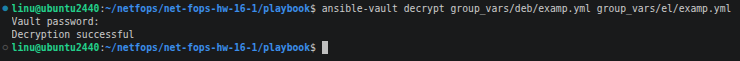

2. Зашифровать отдельное значение `PaSSw0rd` для переменной `some_fact` паролем `netology`. Добавить полученное значение в `group_vars/all/exmp.yml`.

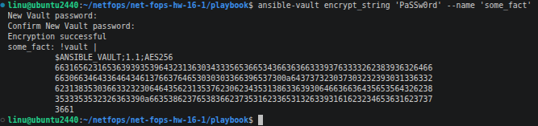

3. Запустить `playbook`, убедиться, что для нужных хостов применился новый `fact`.

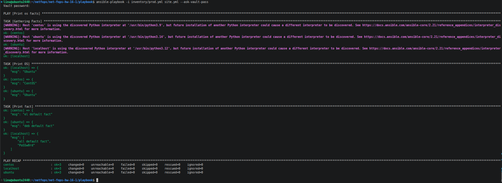

4. Добавить новую группу хостов `fedora`, самостоятельно придумать для неё переменную. В качестве образа можно использовать [этот вариант](https://hub.docker.com/r/pycontribs/fedora).

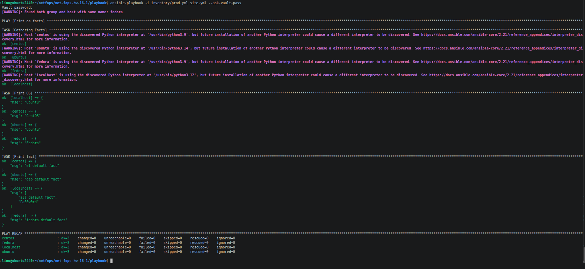

5. Написать скрипт на bash: , который будет автоматизировать поднятие необходимых контейнеров, запуск ansible-playbook и остановку контейнеров.

[Script](https://github.com/expgt/net-fops-hw-16-1/blob/main/playbook/16-1-2-5.sh)

6. Все изменения должны быть зафиксированы и отправлены в личный репозиторий.